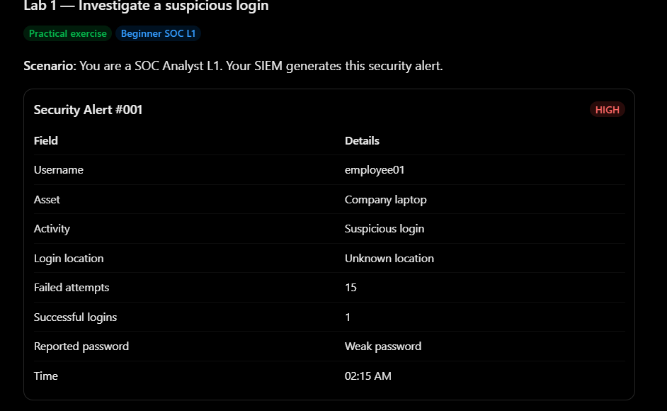

 Lab 1 — Investigate a Suspicious Login
Scenario

You are a SOC Analyst L1. Your SIEM generates the following security alert.

Alert ID: Security Alert #001
Severity: HIGH
Username: employee01
Asset: Company laptop
Activity: Suspicious login
Login location: Unknown location
Failed attempts: 15
Successful logins: 1
Reported password: Weak password
Time: 02:15 AM

*Questions and Answers*

1. What is the asset?

Answer: The asset is the employee's company laptop and user account (employee01).
Example: The laptop contains company files, employee information, and confidential business data.

2. What is the possible threat?

Answer: A hacker attempting to gain unauthorised access to the employee's account through a brute-force attack.

Example: An attacker repeatedly tries different passwords until the correct password is found.

3. What is the vulnerability?

**Answer**: The vulnerability is the employee's weak password, which makes the account easier to compromise.

Example: A simple password such as 123456 can be easily guessed.

4. How could an attacker exploit this vulnerability?

Answer: An attacker could perform multiple login attempts using different password combinations to guess the employee's weak password.

Example: The alert shows 15 failed login attempts followed by 1 successful login from an unknown location. This could indicate that an attacker successfully guessed the password.

5. What is the potential risk?

Answer: The attacker may gain unauthorised access to the employee's account and company information.

Example: The attacker could steal confidential files, modify company data, or misuse the employee's account.

6. Suggest one preventive control.

Answer: Implement Multi-Factor Authentication (MFA).

Example: Even if an attacker guesses the employee's password, they still need an additional authentication factor to access the account.

7. Suggest one detective control.

Answer: Implement SIEM Monitoring.

Example: The SIEM detects 15 failed login attempts followed by a successful login from an unknown location and alerts the SOC team.

8. Suggest one corrective control.

Answer: Reset the Password and Secure the Account.

Example: If the account is confirmed to be compromised, reset the password, revoke active sessions, and investigate suspicious account activity.

9. Which CIA principles could be affected?

Answer: All three CIA principles could be affected.

Confidentiality: Protects information from unauthorised access.

Example: An attacker may steal confidential company files from the employee's account.

Integrity: Protects information from unauthorised modification.

Example: An attacker may modify or delete important company documents.

Availability: Ensures information and systems are accessible when needed.

Example: An attacker may lock the employee out of their account, preventing access to company files.

**Conclusion**

The alert indicates suspicious login activity with 15 failed attempts followed by 1 successful login from an unknown location. The weak password increases the risk of account compromise. However, this does not confirm that an attack was successful. The SOC analyst must investigate the login activity before reaching a conclusion.