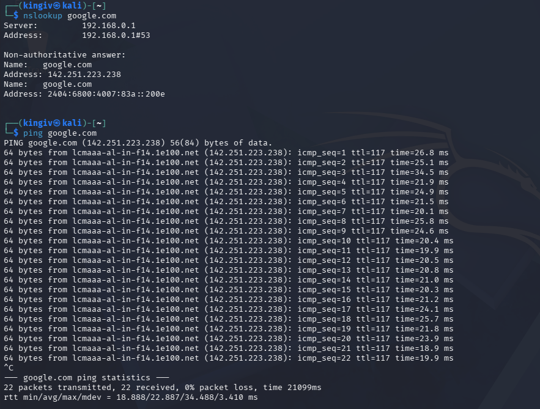
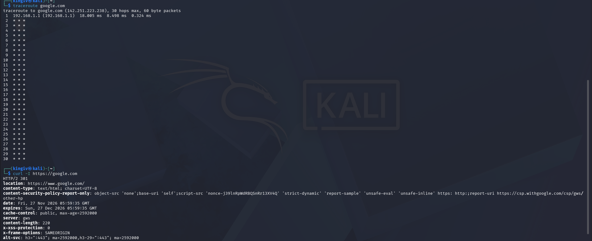

 <h1>Network Investigation – Practical 01</h1>
Objective:

To investigate how a real website communicates over a network using DNS, ICMP, routing, and HTTP/HTTPS protocols.

Target Domain: google.com

1. DNS Investigation

Command:

bash
nslookup google.com

Definition:

DNS (Domain Name System) translates domain names into IP addresses so computers can locate servers.

What is nslookup?

A command-line tool used to query DNS servers and retrieve DNS records for a domain.

Why do we use it?

To find the IP address of a domain.
To identify the DNS server responding to the query.
To troubleshoot DNS resolution problems.

Observe:

Domain name: google.com
Resolved IP address.
DNS server used.
2. Network Connectivity

Command:

bash
ping google.com

Definition:

Network connectivity is the ability of devices to communicate with each other over a network.

What is ping?

A network diagnostic command that uses ICMP (Internet Control Message Protocol) to send Echo Requests and receive Echo Replies.

Why do we use it?

To check whether a destination responds.
To measure network latency.
To identify packet loss.
To troubleshoot connectivity issues.

Observe:

Destination IP address.
Number of replies received.
Packet loss percentage.
Response time in milliseconds.
3. Network Routing

Command (Windows):

cmd
tracert google.com

Command (Linux/macOS):

bash
traceroute google.com

Definition:

Network routing is the process of forwarding data packets from a source to a destination through different networks.

What is tracert?

A network diagnostic command that identifies the intermediate routers (hops) between your computer and the destination.

Why do we use it?

To understand the path taken by network packets.
To identify intermediate routers.
To investigate network delays.
To troubleshoot routing problems.

Observe:

Number of network hops.
IP addresses of responding routers.
Response time at each hop.
Hops that do not respond.
4. HTTP/HTTPS Investigation

Command:

bash
curl -I https://google.com

Definition:

HTTP (Hypertext Transfer Protocol) is used for communication between web clients and servers.

HTTPS is the secure version of HTTP. It uses TLS encryption to protect data during communication.

What is cURL?

A command-line tool used to send requests to servers and receive responses.

What does -I do?

The -I option sends an HTTP HEAD request to retrieve response headers without downloading the response body.

Why do we use it?

To check whether a web server responds.
To identify HTTP status codes.
To inspect server response headers.
To troubleshoot HTTP/HTTPS communication.

Observe:

HTTP response status code.
Server information, if provided.
Content-Type.
Content-Length, if provided.

Common HTTP Status Codes:

Code	Meaning
200	Request successful
301	Permanent redirect
302	Temporary redirect
403	Access forbidden
404	Resource not found
500	Internal server error
503	Service unavailable
Conclusion

This practical demonstrates four important areas of network communication:

DNS – Resolves domain names into IP addresses.
ICMP – Tests network connectivity.
Routing – Identifies the path taken by network packets.
HTTP/HTTPS – Examines communication between web clients and servers.

These commands are commonly used for network troubleshooting and basic cybersecurity investigations.

  
 
  

## 1. DNS Investigation – `nslookup google.com`

DNS resolution successfulObservations:

- DNS Server: `192.168.0.1` – The DNS server configured on your local network.
- Port: `53` – Standard DNS port.
- Domain: `google.com`
- IPv4 Address: `142.251.223.238`
- IPv6 Address: `2404:6800:4007:83a::200e`
- Non-authoritative answer: The response came from a DNS resolver, not directly from Google's authoritative DNS server.

Conclusion: DNS successfully resolved `google.com` into IPv4 and IPv6 addresses.

## 2. Network Connectivity – `ping google.com`

Connectivity successfulObservations:

- Destination IP: `142.251.223.238`
- Packets transmitted: 22
- Packets received: 22
- Packet loss: 0%
- Minimum response time: 18.888 ms
- Average response time: 22.887 ms
- Maximum response time: 34.488 ms
- TTL: 117

Conclusion: Google responded to all 22 ICMP requests. There was 0% packet loss, indicating successful connectivity during this test.

## 3. Network Routing – `traceroute google.com`

Partial route visibilityObservations:

- Destination: `142.251.223.238`
- Maximum hops: 30
- First hop: `192.168.1.1`
- Remaining hops: No responses received (`* * *`).

What does `* * *` mean?

It means the intermediate router did not respond to the traceroute probes within the timeout period. Routers or firewalls may block or filter these probes.

Conclusion: The first router responded successfully, but the remaining network hops were not visible. This does not necessarily mean the network connection is broken.

## 4. HTTP/HTTPS Investigation – `curl -I https://google.com`

HTTPS response receivedObservations:

- HTTP Status: `301`
- Location: `https://www.google.com/`
- Content-Type: `text/html; charset=UTF-8`
- Server: `gws`
- Content-Length: `220`
- Protocol: HTTP/2

What does 301 mean?

HTTP 301 means Moved Permanently. Google redirects requests from `https://google.com` to `https://www.google.com/`.

Other important headers:

- `cache-control`: Defines caching behavior.
- `content-security-policy-report-only`: Reports potential content security policy violations without enforcing the policy.
- `x-frame-options`: Provides protection against certain clickjacking attacks.
- `alt-svc`: Advertises alternative protocols, including HTTP/3.

Conclusion: Google successfully responded over HTTPS and returned a permanent redirect to its `www` domain.

## Overall Practical Results

| Investigation | Result |
| --- | --- |
| DNS | Successful |
| Ping | 0% packet loss |
| Traceroute | Only first hop visible |
| HTTP/HTTPS | HTTP 301 redirect received |

Final Conclusion: Successfully performed DNS resolution, network connectivity testing, network route discovery, and HTTP/HTTPS header inspection on Google using Kali Linux.

 